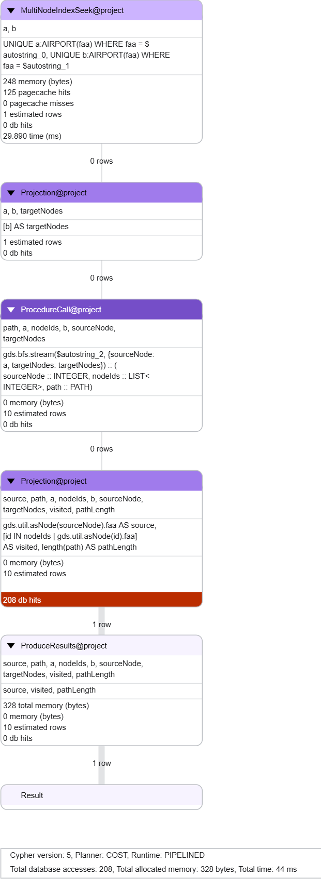
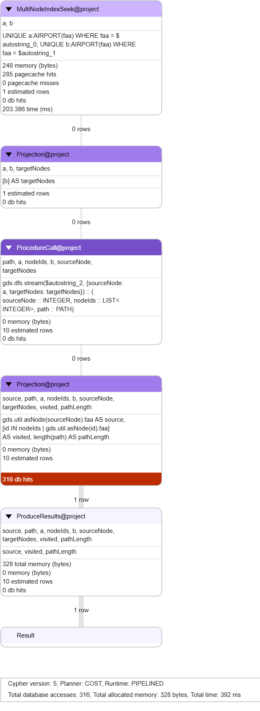
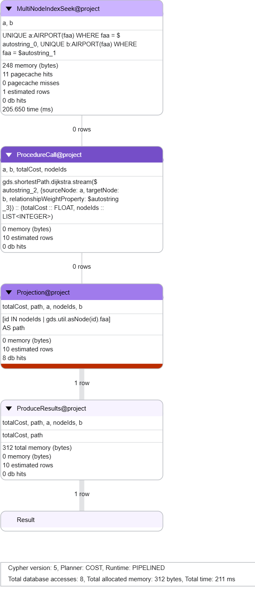
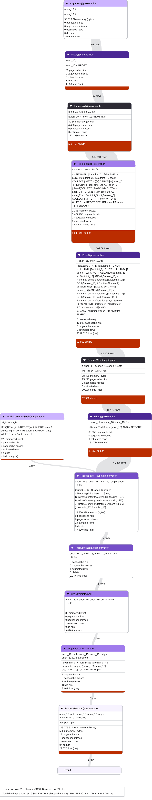
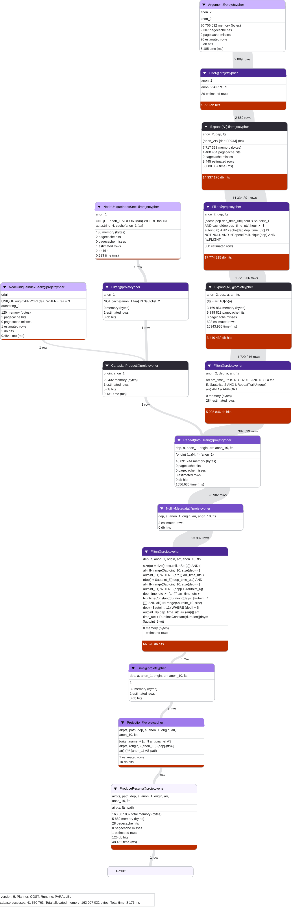
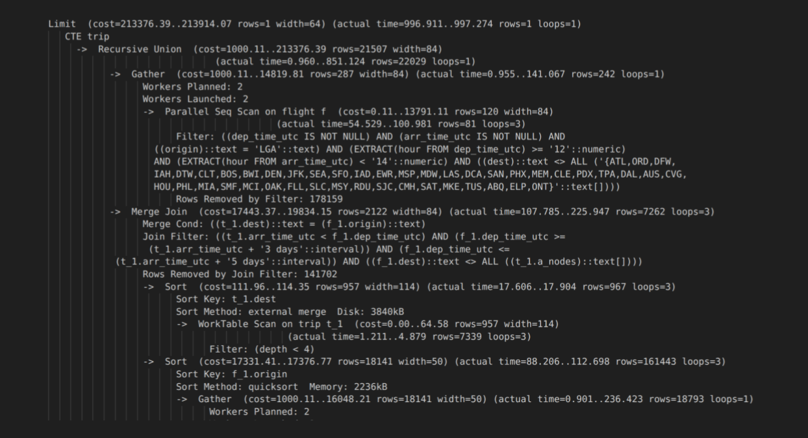
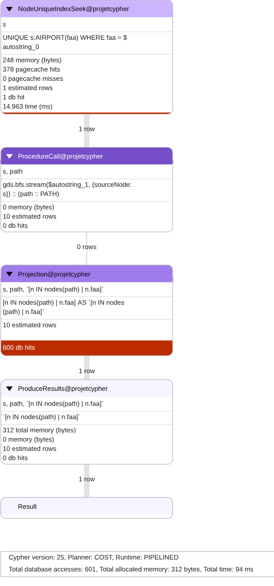
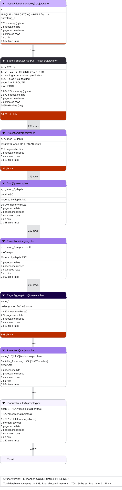

# Cypher_Neo4j_Project

Université Paris Cité
Master 2 Mathématiques/Informatique
Bases de Données Spécialisées

Auteurs :

    NDOUR Fatoumata
    ABONGO Charles-Valentin

Année universitaire : 2025–2026

Ce projet académique propose une étude comparative des langages Cypher 5, Cypher 25 et SQL, ainsi que de la bibliothèque Graph Data Science (GDS), à travers l'analyse de réseaux de transport aérien.

À partir de données réelles, l'étude explore différentes approches de parcours de graphes, de recherche de plus courts chemins et d'exécution de requêtes complexes. Elle vise à évaluer leurs performances, leurs limites et leurs capacités d'optimisation dans les environnements Neo4j et PostgreSQL.

# Articles scientifiques de référence

Dans le répertoire *articles*, vous trouverez un article de référence
pour aborder le sujet de ce projet "Dangers of List Processing in Querying
Property Graphs". Deux autres liens vers deux autres articles sont également
indiqués ci-dessous:

- https://neo4j.com/blog/developer/query-chomp-repeat/

- https://neo4j.com/blog/developer/solve-hard-graph-problems-with-cypher-25/

## Technologies utilisées

- **Python** : préparation, nettoyage et intégration des données.
- **Neo4j** : modélisation et exploitation des bases de données orientées graphes.
- **Cypher 5 et Cypher 25** : interrogation et parcours des graphes.
- **Graph Data Science (GDS)** : exécution d'algorithmes de graphes.
- **PostgreSQL / SQL** : modélisation relationnelle et requêtes récursives.

# Contraintes d'installation

- Python 3.x
- Gestionnaire de package python *pip*
- Neo4j (on supposera ici souvent Neo4j Desktop)
- PostgreSQL

# Provenance et importation des données

Les données collectées proviennnent du jeu de données *nycflights13* et du site *BTS*
(Bureau of Transportation Statistics) qui regorgent de multiples informations sur les aéroports
(*nycflights13*), les compagnies aériennes (*nycflights13*) et les vols commerciaux (*nycflights13*
et *BTS*). Pour *nycflights13*, les informations sur les vols commerciaux portent sur la période de
2013 et partent tous d'un aéroport new-yorkais tandis que pour *BTS*, ce n'est que sur la période de juin 2013
et ce sont des vols entre multiples aéroports aux États-Unis.

Pour *nycflights13*, les données furent obtenues en téléchargeant
le package *nycflights13* via *pip* (le fichier *requirements.txt* stocke l'ensemble
des packages python utiles pour l'import des données). Pour *BTS*, il a fallu aller sur le
[site](https://www.transtats.bts.gov/DL_SelectFields.aspx?gnoyr_VQ=FGJ&QO_fu146_anzr=b0-gvzr)
et utiliser une interface pour sélectionner les données d'intérêt puis télécharger
le fichier résultant en format *CSV* à trouver dans le répertoire *data/* sous le nom
*T_ONTIME_REPORTING.csv*.

# Traitement des données

Pour construire nos bases de données Neo4j et PostgreSQL, il a fallu procéder à un nettoyage des
données. Ce traitement est possible grâce au script python *import_data.py* se trouvant dans le
répertoire *scripts/*.

```bash
python scripts/import_data.py
```


Le résultat de ce traitement conduit à la production de nouveaux fichiers CSV stockés
dans le répertoire *data/*. Pour ce projet, ils ont déjà été produits.

Dans le détail, ce script python charge les données du package *nycflights13* (ayant notamment les trois
dataframes *flights*, *airlines* et *airports*) et celles du
fichier CSV *data/T_ONTIME_REPORTING.csv* (*BTS*). Il fusionne les vols de *nycflights13*
et *BTS* tout en ne gardant que les vols de juin 2013, convertit les heures locales comme
celles de départ et d'arrivée en temps UTC, crée une clé d'identification *id* des vols grâce à une
chaîne de caractères qui concatène les données identifiant un vol de façon unique (l'année,
le mois, le jour, le code de la compagnie aérienne, le numéro de vol, l'origine et la destination
du vol). À la fin, des fichiers CSV sont produits dans *data/* selon si on veut construire
une base de données Neo4j ou PostgreSQL. Explicitons ci-dessous pour chaque fichier, les attributs que décrivent les colonnes:

## *data/airports_cleaned.csv*

- **faa** : code FAA qui identifie un aéroport
- **name** : nom de l'aéroport
- **lat** : latitude de l'aéroport 
- **lon** : longitude de l'aéroport
- **tzone** : fuseau horaire de l'aéroport

## *data/flights_cleaned.csv*

- **id** : clé d'identification d'un vol
- **origin** : code FAA de l'aéroport d'origine du vol
- **dest** : code FAA de l'aéroport de destination du vol
- **carrier** : code IATA désignant la compagnie aérienne
- **flight** : numéro de vol
- **distance** : distance à vol d'oiseau en miles entre les deux aéroports
- **air_time** : temps de vol
- **dep_delay** : retard en minutes par rapport à l'heure prévue de départ
- **arr_delay** : retard en minutes par rapport à l'heure prévue d'arrivée
- **sched_dep_time_utc** : heure prévue de départ en temps UTC (format YYYY-MM-DD-HH:MM)
- **dep_time_utc** : heure de départ du vol en temps UTC 
- **sched_arr_time_utc** : heure prévue d'arrivée du vol en temps UTC 
- **arr_time_utc** : heure d'arrivée du vol en temps UTC 
- **year** : année du vol
- **month** : mois du vol
- **day** : jour du vol

## *data/flights_sql.csv*

Mêmes informations que *data/flights_cleaned.csv* mais sans les attributs **year**, **month** et **day**.
*data/flights_cleaned.csv* conserve l'information de l'année, du mois et
du jour du vol afin que dans *Neo4j* ces informations soient faciles d'accès mais *data/flights_sql.csv* les délaissent
car le timestamp décrivant l'heure d'un vol contient déjà ces informations et on veut dans PostgreSQL éviter la surcharge d'information.

## *data/airlines_cleaned.csv*

- **carrier** : code IATA de la compagnie aérienne
- **name** : nom de la compagnie aérienne

## *data/airport_route_sql.csv*

- **origin** : code FAA de l'aéroport (d'origine)
- **dest** :  code FAA de l'aéroport (de destination)
- **distance** : distance à vol d'oiseau en miles entre les deux aéroports

Cette table désigne l'existence d'au moins un vol entre deux aéroports selon le sens origine-destination du vol.
Donc il est possible que deux aéroports soient liées dans les deux sens. Cette table sera utile pour la base de
données PostgreSQL mais pour la construction de la base de données Neo4j, on ne supposera pas connaître cette table,
même s'il aurait été possible de l'utiliser.

# Intégration des données

## Neo4j

On va supposer que *Neo4j Desktop* a été utilisé pour intégrer les données dans *Neo4j* 

Pour insérer les données dans *Neo4j Desktop*:

- créez une instance locale et activez-la
- copiez les fichiers *data/airlines_cleaned.csv*, *data/airports_cleaned.csv* et
*data/flights_cleaned.csv* dans le dossier *import* du répertoire de l'instance (*instance folder*
accessible en l'ouvrant depuis *Neo4j*)
- sur *Neo4j*, allez dans l'onglet *query* puis connectez-vous à votre instance active
- dans le terminal de requête, copier-collez le contenu du fichier *Neo4j/constraints_indexes.cypher*
qui est dans le projet et exécutez le contenu collé (ce fichier insère le schéma des contraintes et indexes du futur graphe)
- faites comme à l'étape précédente mais avec le fichier *Neo4j/import.cypher* (ce fichier va construire
le graphe à partir des fichiers dans le répertoire *import* du *instance folder*)

À la fin, le graphe des données a été construit.

### Schéma de modélisation Neo4j  

#### Noeud : 
- AIRPORT(faa, name, lat, lon, tzone)

- AIRLINE(carrier, name)

- FLIGHT(id, flight, air_time)

#### Relation 
- (FLIGHT)-[:FROM {sched_dep_time_utc, dep_time_utc, dep_delay}]->(AIRPORT)

- (FLIGHT)-[:TO   {sched_arr_time_utc, arr_time_utc, arr_delay}]->(AIRPORT)

- (FLIGHT)-[:OPERATED_BY]->(AIRLINE)

- (AIRPORT)-[:AIR_ROUTE {distance}]->(AIRPORT)

### Contraintes et index

Le fichier *Neo4j/constraints_indexes.cypher* décrit les contraintes et index de la base de
données Neo4j.

#### Contraintes d'unicité

- airport_faa_unique : pour un noeud AIRPORT, la propriété *faa* doit être unique si elle existe
- airline_carrier_unique : pour un noeud AIRLINE, la propriété *carrier* doit être unique si elle existe
- flight_id_unique : pour un noeud FLIGHT, la propriété *id* doit être unique si elle existe

Remarque : les contraintes d'unicité induisent la création d'un index sur les noeuds

#### Index

Il y a un index pour toutes les relations de label :FROM, :TO et AIR_ROUTE basé sur chaque propriété s'y trouvant.
Ce choix de mettre des index un peu partout peut être jugé excessif mais ceci a été décidé de
sorte à être sûr de minimiser le coût en temps de la recherche d'un élément en toute
circonstance, quitte à augmenter le coût en mémoire.


## PostgreSQL

Pour insérer les données dans PostgreSQL :

- ouvrez un terminal et placez-vous dans le répertoire du projet
- faites la commande *psql* pour ouvrir l'application
- placez-vous dans la base de données qui vous convient
- exécutez: \i postgres/schema.sql
- exécutez: \i postgres/import.sql

La commande *\i postgres/schema.sql* importe le schéma qu'on impose à nos futures données.
La commande *\i postgres/import.sql* importe les données depuis les fichiers *data/airport_route_sql.csv*,
*data/flights_sql.csv*, *data/airlines_cleaned.csv*, *data/airports_cleaned.csv*.

À la fin des 5 étapes, les données sont dans PostgreSQL.

### Schéma de modélisation PostgreSQL 

 Les tables PostgreSQL *airport*, *airline*, *flight* et *airport_route* ne sont que l'équivalent PostgreSQL des tables CSV
*data/airports_cleaned.csv*, *data/airlines_cleaned.csv*, *data/flights_sql.csv* et *data/airport_route_sql.csv*
vues à la partie **Traitement des données**.

Remarque: voir le fichier *postgres/schema.sql* pour le détail du schéma relationnel.

### Contraintes et index

Le fichier *postgres/schema.sql* décrit également les contraintes et index de la base de
données PostgreSQL.

#### Table *airport*

- Clé primaire : **faa**

#### Table *airline*

- Clé primaire : **carrier**

#### Table *flight*

- Clé primaire : **id**
- Clé étrangère : **origin** pointant l'attribut **faa** de la table *airport*
- Clé étrangère : **dest** pointant l'attribut **faa** de la table *airport*
- Clé étrangère : **carrier** pointant l'attribut **carrier** de la table *airline*

#### Table *airport_route*

- Clé primaire : **(origin_faa, dest_faa)**
- Clé étrangère : **origin_faa** pointant l'attribut **faa** de la table *airport*
- Clé étrangère : **dest_faa** pointant l'attribut **faa** de la table *airport*

#### Index

- Index sur la table *flight* sur les attributs **sched_dep_time_utc**, **sched_arr_time_utc**,
**dep_time_utc**, **arr_time_utc**, **dep_delay** et **arr_delay**

- Index sur la table *airport_route* sur l'attribut **distance**


# Requêtes Cypher

Cette section est consacrée à l’étude et à la comparaison de différentes requêtes de graphes
exprimées en Cypher, dans ses versions 5 et 25, ainsi qu’à l’aide de la librairie Graph Data
Science (GDS). L’objectif n’est pas uniquement de produire des résultats, mais d’analyser
les stratégies d’exécution mises en œuvre par le moteur Neo4j, d’identifier les algorithmes
effectivement utilisés, et de mettre en évidence les limites et apports de chaque approche.

Les problèmes étudiés portent principalement sur le calcul de chemins dans un graphe
d’aéroports, qu’ils soient non pondérés, pondérés, ou soumis à des contraintes globales.
Pour chaque problème, plusieurs tentatives de résolution sont présentées, accompagnées
d’une analyse des plans d’exécution (`PROFILE`) afin de comprendre le comportement réel
du moteur.

## Problèmes étudiés
Les problèmes étudiés dans cette partie sont les suivants :

- le calcul du plus court chemin non pondéré entre deux aéroports ;
- le calcul du plus court chemin pondéré, en tenant compte de la distance entre aéroports ;
- la recherche de chemins satisfaisant des contraintes globales (monotonie des distances,
  égalité des horaires, durée totale de vol) ;
- l’implémentation de parcours de graphe (BFS) à l’aide de motifs de chemins variables et
  d’éléments répétables introduits en Cypher 25.

### Choix de la relation AIR_ROUTE

La relation `AIR_ROUTE` est privilégiée car elle fournit un graphe simple et stable entre aéroports,
adapté à l’étude des plus courts chemins, contrairement au graphe basé sur les vols (`FLIGHT`),
beaucoup plus riche mais moins approprié à l’analyse algorithmique.  
Ce problème de modélisation, lié à l’utilisation d’un graphe trop granulaire basé sur les vols,
est également discuté dans l’article *Dangers of List Processing in Querying Property Graphs*,
ce qui justifie l’usage de la relation `AIR_ROUTE` pour l’étude des chemins.


### Bornes sur la longueur des chemins et conditions expérimentales

Pour certaines requêtes de parcours de graphe, en particulier celles reposant sur des chemins
de longueur variable ou sur des accumulations globales, l’exploration non bornée conduit à une
explosion combinatoire et à des temps d’exécution très élevés, voire à des requêtes qui ne
terminent pas. Afin d’assurer la terminaison des requêtes et de rendre l’analyse expérimentale
possible, une borne maximale sur la longueur des chemins a été fixée à 6 arêtes.

Ce choix ne vise pas à modifier la nature des problèmes étudiés, mais à contrôler l’espace de
recherche et à permettre une comparaison équitable entre les différentes approches (Cypher 5,
Cypher 25, GDS et SQL). Il reflète également une pratique courante en analyse de graphes, où les
parcours sont souvent bornés pour éviter des explorations inutiles.

Par ailleurs, un `LIMIT 500` est systématiquement appliqué aux requêtes lors de l’analyse des
plans d’exécution (`PROFILE`). Cette limite permet de comparer les temps d’exécution et les
coûts observés dans des conditions identiques, sans que le volume des résultats retournés ne
biaise les mesures. Il est important de noter que ce `LIMIT` n’influence pas la stratégie
d’exploration du graphe, mais uniquement la taille des résultats produits.


## Plus court chemin non pondéré

Ce premier problème consiste à déterminer le plus court chemin entre l’aéroport **YUM**
(Yuma International Airport) et l’aéroport **ABE** (Lehigh Valley International Airport)
en termes de nombre d’arêtes, sans prendre en compte de pondération sur les relations.
Il s’agit d’un problème classique de parcours de graphe, permettant d’analyser les capacités
natives de Cypher en matière de traversée et d’optimisation.

Dans cette partie, nous comparons les approches proposées par Cypher 5, Cypher 25 et la
librairie Graph Data Science (GDS), en nous appuyant sur les résultats obtenus et sur l’analyse
des plans d’exécution.

### Cypher 5

La requête non pondérée exécutée en Cypher 5, correspondant à la **requête n°2** du fichier  
**`queries_cypher5.cypher`**, permet d’identifier un chemin minimal de longueur **3 arêtes**
entre les aéroports **YUM** et **ABE**. Le plan d’exécution montre que le moteur Neo4j utilise
l’opérateur `ShortestPath`, ce qui correspond à l’application d’un algorithme de parcours en
largeur (BFS) bidirectionnel. Les nœuds source et destination sont localisés efficacement à
l’aide d’un `MultiNodeIndexSeek`, exploitant les index définis sur la propriété `faa`.

D’un point de vue performance, l’exécution reste peu coûteuse : le temps total mesuré est de  
**205 ms**, avec **43 accès** à la base de données et une consommation mémoire de  
**3 168 octets**. Ces résultats illustrent l’efficacité du calcul natif du plus court chemin
non pondéré dans Cypher 5, qui évite toute exploration exhaustive des chemins possibles.
<p align="center">
  
  
</p>

### Cypher 25

La requête non pondérée exécutée en **Cypher 25**, correspondant à la **requête n°4** du fichier  
**`queries_cypher25.cypher`**, permet d’identifier un chemin minimal de longueur **3 arêtes**
entre les aéroports **YUM** et **ABE**. Le résultat obtenu est identique à celui observé en
**Cypher 5**, ce qui confirme que le changement de syntaxe n’affecte pas la solution calculée.

L’analyse du plan d’exécution met en évidence l’utilisation de l’opérateur **`ShortestPath`**,
indiquant que le moteur Neo4j applique le même algorithme de parcours en largeur
(**BFS bidirectionnel**) que dans la version précédente. Les nœuds source et destination sont
localisés efficacement à l’aide d’un **`MultiNodeIndexSeek`**, exploitant les index définis sur
la propriété **`faa`**.

Du point de vue des performances, l’exécution est très efficace : le temps total mesuré est de
**10 ms**, pour **45 accès** à la base de données et une consommation mémoire de
**3 168 octets**. Ces résultats montrent que **Cypher 25** conserve les optimisations internes
de **Cypher 5** tout en offrant une syntaxe plus expressive, sans surcoût mesurable en temps
ou en mémoire.
<p align="center">
  
  
</p>

### GDS — BFS et DFS 

Pour compléter l’étude du plus court chemin non pondéré, nous avons utilisé les algorithmes
BFS et DFS de la librairie Graph Data Science (GDS), via les requêtes n°1 (BFS) et n°2 (DFS)
du fichier `queries_cypher_GDS.cypher`. Contrairement à `shortestPath` en Cypher, ces
procédures nécessitent la spécification explicite d’un nœud source et d’un nœud cible.

Le BFS GDS effectue une exploration directionnelle à partir du nœud source et retourne un
chemin de longueur 102 arêtes, avec un temps d’exécution de 44 ms et 208 accès à la base de
données. Le DFS GDS, qui ne garantit aucune optimalité, retourne un chemin encore plus long
de 156 arêtes, pour un temps d’exécution de 392 ms et 316 accès.

Cette différence s’explique par le fait que le BFS utilisé par Cypher via l’opérateur
`ShortestPath` est bidirectionnel, tandis que les algorithmes BFS et DFS de GDS sont
directionnels. Ainsi, malgré une exécution en mémoire, les algorithmes GDS génériques ne
sont pas adaptés au calcul de plus courts chemins non pondérés lorsque l’optimalité en
nombre d’arêtes est recherchée.
<p align="center">
  
  
</p>

### PostgreSQL 

La **requête n°5** du fichier **`recursive_queries.sql`** vise à calculer le plus court
chemin non pondéré à l’aide d’une requête récursive. En pratique, cette requête conduit
à une exploration récursive bornée du graphe et ne termine pas dans un temps
raisonnable. Aucun résultat exploitable n’a donc pu être obtenu.

Ce comportement illustre les limites des approches récursives SQL pour les parcours
de graphe non pondérés, en l’absence d’optimisation algorithmique dédiée telle qu’un
parcours en largeur contrôlé.

### Comparaison 

Pour le calcul du plus court chemin non pondéré entre les aéroports YUM et ABE, Cypher 5 et
Cypher 25 reposent sur l’opérateur `ShortestPath`, implémentant un parcours en largeur
bidirectionnel. Les deux versions retournent un chemin minimal de longueur 3 arêtes, avec
des coûts d’exécution comparables, ce qui montre qu’elles sont équivalentes sur le plan
algorithmique pour ce problème.

À l’inverse, les algorithmes BFS et DFS de GDS effectuent des explorations directionnelles à
partir du nœud source. Malgré la spécification explicite de la cible, le BFS GDS retourne un
chemin de longueur 106 arêtes et le DFS un chemin de 156 arêtes, illustrant l’absence de
stratégie bidirectionnelle et, pour DFS, l’absence de garantie d’optimalité.

Enfin, l’implémentation en PostgreSQL à l’aide de requêtes récursives ne permet pas d’obtenir
de résultat exploitable dans un temps raisonnable pour ce cas non pondéré, bien qu'avec une
exploration récursive bornée du graphe. Cette limite confirme que les approches SQL
génériques sont peu adaptées aux parcours de graphe non pondérés à grande échelle.

Dans ce contexte, les fonctionnalités natives de Cypher apparaissent comme les plus adaptées
au calcul de plus courts chemins non pondérés, tandis que GDS et PostgreSQL se révèlent plus
pertinents pour d’autres types d’analyses ou de contraintes spécifiques.

## Plus court chemin pondéré

Dans cette seconde partie, nous cherchons à déterminer le plus court chemin entre les aéroports  
YUM et ABE en tenant compte d’une **pondération sur les relations**, ici la distance associée  
aux relations `AIR_ROUTE`. Contrairement au cas non pondéré, l’objectif n’est plus de minimiser  
le nombre d’arêtes, mais le **coût total cumulé** le long du chemin.

Ce problème permet d’étudier les limites des fonctionnalités natives de Cypher pour les  
chemins pondérés, ainsi que les différences de comportement entre Cypher 5, Cypher 25 et  
les algorithmes dédiés de la librairie Graph Data Science (GDS).

### Cypher 5 

Le calcul du plus court chemin pondéré en Cypher 5 repose sur la **requête n°3** du fichier
`queries_cypher5.cypher`. En l’absence d’un algorithme natif de type Dijkstra, le moteur
Cypher explore exhaustivement tous les chemins possibles jusqu’à une longueur maximale
de 6 arêtes, puis calcule le coût total de chaque chemin a posteriori.

Le plan d’exécution met en évidence l’utilisation de `VarLengthExpand`, entraînant une
explosion combinatoire avec plus de 880 000 chemins générés et près de 591 millions
d’accès à la base de données. Cette stratégie se traduit par un temps d’exécution très
élevé, d’environ 99 secondes, pour une consommation mémoire de 84 160 octets.

Bien que le chemin retourné corresponde bien au coût minimal entre YUM et ABE, ces
résultats montrent que Cypher 5, malgré son expressivité, n’est pas adapté au calcul
efficace de plus courts chemins pondérés sans algorithme dédié.
<p align="center">
  
  
</p>

### Cypher 25 

Le calcul du plus court chemin pondéré en Cypher 25 s’appuie sur la **requête n°5** du fichier
`queries_cypher25.cypher`, qui étend l’approche Cypher 5 par l’utilisation de
`REPEATABLE ELEMENTS`. Cette extension améliore le contrôle syntaxique de l’exploration
des chemins tout en conservant une borne sur leur longueur.

Cependant, le plan d’exécution montre que l’algorithme sous-jacent reste inchangé :
l’opérateur `VarLengthExpand` effectue une exploration exhaustive des chemins avant le
calcul du coût total par agrégation. Plus de 880 000 chemins sont générés, entraînant
environ 592 millions d’accès à la base de données et un temps d’exécution d’environ
77 secondes, pour une consommation mémoire de 84 160 octets.

Le chemin retourné est correct, mais ces résultats confirment que, malgré une meilleure
expressivité, Cypher 25 ne résout pas le problème de scalabilité du calcul de plus courts
chemins pondérés en l’absence d’un algorithme dédié tel que Dijkstra.
<p align="center">
  
  
</p>

### GDS 

Le calcul du plus court chemin pondéré avec GDS est réalisé via la requête n°3 du fichier
`queries_cypher_GDS.cypher`, en utilisant la procédure
`gds.shortestPath.dijkstra.stream`. Contrairement à Cypher, cette approche repose sur
l’algorithme dédié de Dijkstra, spécifiquement conçu pour les graphes pondérés.

Le plan d’exécution montre une exploration ciblée du graphe, sans génération exhaustive
des chemins. Seuls 8 accès à la base de données sont nécessaires, pour un temps
d’exécution de 211 ms et une consommation mémoire de 312 octets. Le chemin retourné est
identique à celui obtenu avec Cypher, mais calculé de manière beaucoup plus efficace.

Ces résultats confirment que l’utilisation de GDS et de Dijkstra est la solution la plus
adaptée et la plus scalable pour le calcul de plus courts chemins pondérés.
<p align="center">
  
</p>

### PostgreSQL 

Le calcul du plus court chemin pondéré en PostgreSQL repose sur la **requête récursive n°4**
du fichier `recursive_queries.sql`. Cette approche simule un parcours de graphe via un
`WITH RECURSIVE`, en générant et en étendant progressivement l’ensemble des chemins
possibles.

Le plan d’exécution met en évidence une explosion combinatoire, avec plus de 10 millions
de chemins intermédiaires produits avant filtrage. Malgré l’utilisation d’index, le temps
d’exécution atteint environ 8,8 secondes, principalement dû aux boucles imbriquées et au
tri final pour sélectionner le chemin minimal.

Bien que le résultat retourné soit correct, cette expérience montre que les requêtes
récursives SQL sont peu adaptées et peu scalables pour le calcul intensif de plus courts
chemins pondérés, en comparaison avec des algorithmes dédiés comme Dijkstra dans GDS.
<p align="center">
  
</p>

### Synthèse comparative 

Les approches Cypher 5, Cypher 25 et PostgreSQL reposent toutes sur une exploration
exhaustive des chemins, suivie d’un calcul du coût total, ce qui entraîne une explosion
combinatoire et des temps d’exécution élevés. L’ajout de `REPEATABLE ELEMENTS` en
Cypher 25 améliore l’expressivité mais n’apporte pas de gain algorithmique réel.

À l’inverse, GDS utilise l’algorithme de Dijkstra, évitant l’exploration exhaustive et
garantissant des performances stables et efficaces. Ces résultats montrent que, pour
les chemins pondérés, les algorithmes dédiés de GDS sont nettement plus adaptés que les
approches déclaratives génériques.

## Recherche de chemins satisfaisant des contraintes globales

Cette partie s’intéressent à des problèmes où les contraintes portent sur l’ensemble du chemin. Les contraintes étudiées concernent la monotonie des distances, l’égalité des horaires d’arrivée et la durée totale de vol.

Ces problématiques mettent en évidence le lien étroit entre expressivité du langage,
modélisation du graphe et faisabilité des requêtes, ainsi que les différences entre
Cypher 5, Cypher 25 et PostgreSQL.

### Contrainte globale — Distance strictement croissante (AIR_ROUTE)

Ce premier cas consiste à rechercher des chemins tels que la distance portée par chaque
relation `AIR_ROUTE` soit strictement croissante le long du chemin. Il s’agit d’une
contrainte globale nécessitant de comparer les propriétés successives des arêtes du
chemin.

#### Cypher 5

La **requête n°1** du fichier **`queries_cypher5.cypher`** exprime la contrainte de
distance strictement croissante en Cypher 5 par une **exploration exhaustive des chemins**
suivie d’un **filtrage a posteriori(NOT EXISTS)**. Le moteur génère tous les chemins possibles
(jusqu’à 6 arêtes) via `VarLengthExpand`, puis reconstruit les relations pour vérifier
la monotonie des distances.

Cette approche entraîne une forte explosion combinatoire : plus de **1,4 million de
chemins** sont produits, pour **11 866 661 accès** à la base et un temps d’exécution de
**11 131 ms**, avec **330 760 octets** de mémoire allouée.

Ce résultat illustre une limite majeure de **Cypher 5** : l’impossibilité d’imposer des
contraintes globales pendant la traversée, ce qui dégrade fortement les performances
par rapport à Cypher 25.
<p align="center">
  
  
</p>

#### Cypher 25 

La **requête n°1** du fichier **`queries_cypher25.cypher`** recherche des chemins dont les distances  
`AIR_ROUTE` sont **strictement croissantes**. Le plan d’exécution repose sur  
**`Repeat(All, Walk)`** combiné à **`allReduce`**, ce qui permet de vérifier la contrainte  
**pendant la traversée** du graphe.

L’exécution reste efficace avec **95 ms**, **13 616 accès** à la base et  
**585 408 octets** de mémoire, pour **500 chemins** retournés.  
Ce résultat montre que **Cypher 25** permet d’exprimer naturellement des **contraintes globales  
sur les chemins**, là où Cypher 5 nécessite des constructions plus coûteuses et moins lisibles.
<p align="center">
  
  
</p>

#### PostgreSQL 

La **requête n°1** du fichier **`recursive_queries.sql`** exprime la contrainte de  
**distances strictement croissantes** à l’aide d’une requête récursive (`WITH RECURSIVE`).  
L’extension des chemins est contrôlée par la condition `distance > last_distance`, avec  
une borne de longueur fixée à 6.

Le plan d’exécution repose sur un **`Recursive Union`** et des scans récursifs sur la table  
intermédiaire des chemins. Grâce aux bornes et au `LIMIT 500`, l’exécution reste efficace,  
avec un temps total de **1.03 ms** pour **500 chemins retournés**.

Cette approche montre que PostgreSQL peut gérer des contraintes globales simples sur des  
chemins bornés, mais au prix d’une écriture récursive explicite, moins expressive et moins  
robuste que l’approche native de **Cypher 25** avec `allReduce`.
<p align="center">
  
</p>

#### Comparaison 

Pour cette contrainte globale, **Cypher 5** vérifie la monotonie des distances après une
exploration exhaustive des chemins, ce qui entraîne des temps d’exécution élevés
(≈ **11 s**) et un nombre important d’accès à la base de données.

**Cypher 25** intègre la contrainte directement dans la traversée grâce à `allReduce`,
réduisant l’exploration inutile. Cette approche est nettement plus performante, avec
un temps d’exécution d’environ **95 ms**, un nombre d’accès limité (**13 616**) et une
consommation mémoire maîtrisée.

**PostgreSQL** propose une implémentation récursive efficace dans ce cas borné, avec un
temps d’exécution d’environ **1 ms** pour **500 chemins**, mais au prix d’une récursion
explicite moins expressive et plus fragile si la profondeur augmente.

Ainsi, **Cypher 25** offre le meilleur compromis entre expressivité et performance,
tandis que PostgreSQL reste efficace uniquement sous de fortes contraintes de bornage.

### Contrainte globale — Égalité des horaires d’arrivée

Cette seconde contrainte globale consiste à rechercher des chemins composés de vols
arrivant exactement à la même heure (`arr_time_utc`). Contrairement aux contraintes
basées sur `AIR_ROUTE`, cette problématique dépend directement des propriétés portées
par les relations `TO` dans la modélisation `FLIGHT–FROM–TO`.

Cette contrainte est globale au chemin, car elle impose une égalité entre les horaires
d’arrivée de l’ensemble des vols composant le chemin. Elle ne peut pas être exprimée
de manière équivalente en Cypher 5, en raison à la fois des limites du langage et de la
modélisation orientée vols. Elle est en revanche exprimable directement en Cypher 25
et en PostgreSQL.

#### Cypher 25 

La contrainte d’égalité des horaires d’arrivée est exprimée en Cypher 25 via la
**requête n°2** du fichier `queries_cypher25.cypher`. Elle impose que tous les vols
composant un chemin partagent la même valeur de `arr_time_utc`, ce qui constitue
une contrainte globale sur le chemin.

Le plan d’exécution montre l’utilisation de `REPEATABLE ELEMENTS` combiné à
`allReduce`, permettant de propager et de vérifier l’égalité de l’horaire à chaque
étape de l’expansion. Cette expressivité n’est pas disponible en Cypher 5 avec la
modélisation `FLIGHT–FROM–TO`.

D’un point de vue performance, l’exécution est coûteuse : le temps total atteint
**22 769 ms**, avec **96 955 729 accès** à la base de données et une consommation
mémoire de **2 113 544 octets**. Cette charge élevée s’explique par l’exploration
d’un grand nombre de combinaisons de vols avant filtrage par la contrainte globale.

Malgré ce coût, Cypher 25 permet de formuler directement une contrainte temporelle
globale sur les chemins, ce qui confirme un gain majeur en expressivité par rapport
à Cypher 5, au prix d’une scalabilité limitée.
<p align="center">
  
  
</p>

#### PostgreSQL 

La contrainte d’égalité des horaires d’arrivée est traitée en PostgreSQL via une
requête récursive (**requête n°2 – `recursive_queries.sql`**) fondée sur
`WITH RECURSIVE`. Le moteur simule un parcours de graphe en chaînant les vols
ayant le même `arr_time_utc`.

L’exécution repose sur un `Recursive Union` combiné à des jointures et des scans
sur la table intermédiaire des chemins. Malgré l’absence d’algorithme dédié au
plus court chemin, la requête s’exécute en **327 ms**, grâce à la borne sur la
profondeur et au **JIT activé**. Le volume de chemins explorés reste toutefois
important (**≈ 1,5 million estimés**), ce qui limite la scalabilité.

PostgreSQL fournit ici une solution **rapide**, mais **spécifique** et peu
généralisable à des contraintes plus complexes sur les chemins.
<p align="center">
  
</p>

#### Comparaison 

Cypher 25 (**requête n°2 – `queries_cypher25.cypher`**) permet d’exprimer
nativement une contrainte globale d’égalité des horaires grâce à
`REPEATABLE ELEMENTS` et `allReduce`, au prix d’une exploration combinatoire
coûteuse (**22 769 ms**, **≈ 97 M accès**, **2,1 Mo mémoire**).

PostgreSQL est **nettement plus rapide** (**327 ms**) et plus économe en mémoire,
mais repose sur une **logique récursive ad hoc**, sans sémantique graphe native.

En résumé :
- **PostgreSQL** : plus performant sur ce cas précis.
- **Cypher 25** : plus expressif et mieux adapté aux contraintes globales sur
  chemins, mais moins scalable.

### Chemins sous contrainte de durée totale de vol

Ce problème consiste à identifier des chemins de vols dont la **durée totale de vol**
(donnée par la somme des attributs `air_time`) est **strictement supérieure à 180 minutes**.
Il s’agit d’une contrainte **globale sur le chemin**, non exprimable localement sur une
seule relation.

#### Cypher 25 

La contrainte de durée totale est traitée en **Cypher 25** via la **requête n°3**
du fichier `queries_cypher25.cypher`, en s’appuyant sur `REPEATABLE ELEMENTS`
et un `allReduce` accumulant l’attribut `air_time` le long du chemin.

Le plan d’exécution montre une exploration contrôlée par `Repeat(All, Walk)`
avec agrégation incrémentale du temps total. L’exécution atteint un temps total
de **197 ms**, pour **33 212 accès** à la base de données et une consommation
mémoire de **636 184 octets**. La borne sur la longueur du chemin limite
l’explosion combinatoire, tout en permettant d’exprimer une contrainte globale
sur le chemin, impossible à formuler en Cypher 5 avec cette modélisation.
<p align="center">
  
  
</p>

#### PostgreSQL 

L’équivalent PostgreSQL est implémenté via la **requête n°3** du fichier
`recursive_queries.sql`, à l’aide d’une requête récursive (`WITH RECURSIVE`)
qui accumule la durée totale de vol.

Le plan repose sur un `Recursive Union` générant un très grand nombre de chemins
intermédiaires, avec une estimation théorique dépassant **10¹⁰ chemins**.
En pratique, l’exécution est stoppée par le `LIMIT`, mais le moteur explore
massivement la table intermédiaire. Le temps total observé est de **158 ms**,
au prix d’une **explosion combinatoire** fortement dépendante de la borne
sur la longueur des chemins.
<p align="center">
  
</p>

#### Comparaison — Contrainte de durée totale de vol

Pour cette contrainte globale, **Cypher 25** et **PostgreSQL** sont tous deux
expressifs, contrairement à Cypher 5. PostgreSQL offre de bonnes performances
sur ce cas précis, mais au prix d’une exploration récursive difficilement
scalable lorsque la borne augmente.

Cypher 25 fournit une formulation plus naturelle et plus sûre du point de vue
de la modélisation graphe, avec un coût maîtrisé et une intégration directe
dans le moteur Neo4j. En termes de **scalabilité**, Cypher 25 apparaît plus
robuste, tandis que PostgreSQL reste une solution acceptable uniquement pour
des profondeurs de chemin faibles.

### Voyage en n vols

Avec la base de données Neo4j qui relate multiples vols dans les États-Unis sur la période de juin 2013, on
peut produire multiples requêtes. On propose ici la question suivante: pour n un nombre fixé, existe-t-il
un voyage en n vols de New-York (aéroport de La Guardia) jusqu'à l'aéroport de Los Angeles avec les contraintes
temporelles suivantes?:

- 1) l'heure d'arrivée d'un vol doit être une heure antérieure à l'heure de départ du vol suivant (contrainte naturelle)
- 2) chaque ville intermédiaire lors du voyage va être visité et on suppose pour ces villes qu'on y reste qu'entre trois à cinq jours avant de repartir.

On rajoute aussi une contrainte physique qui est qu'on ne peut pas revisiter un même aéroport.

Une telle requête est transcriptible aussi bien en Cypher 5 que 25 et même en PostgreSQL. La problématique est donc de comparer les performances
dans chacun des cas et les éventuelles difficultés. On choisit n=4 vols
pour les tests.

#### Comparaison entre Cypher 5 et Cypher 25

En Cypher 25, la requête va utiliser la fonction allReduce qui a comme
particularité de rendre inline une variable de groupe provenant
d'un quantified graph pattern, ce qui permet d'élaguer assez
tôt des chemins qui ne vérifieraient pas les propriétés demandées.

La **requête n°6** du fichier `queries_cypher25.cypher` prend en général une dizaine de secondes environ malgré le fait que sur le mois
de juin 2013 en moyenne un aéroport voyait 1782 vols décoller. Pour
l'aéroport de La Guardia, on monte à 8157 et pour certains aéroports, on monte à
plus de 20000 avec un maximum à 33619 pour l'aéroport de Hartsfield Jackson Atlanta.
Donc sans recherche optimisée, on est amené à comparer 1782⁴ suites de 4 vols, ce qui
est de l'ordre de 10000 milliards. L'avantage du *allReduce* est donc d'éviter d'explorer
toutes les chemins possibles, ce qui permet le retour d'une réponse en un temps raisonnable
. Néanmoins la requête est coûteuse (coût mémoire et db hits) comme le confirme le plan d'exécution obtenu avec PROFILE:
<p align="center">
  
</p>

Si on transcrit l'équivalent de cette requête en Cypher 5, l'absence de inline conduit à une explosion combinatoire de chemins à vérifier,
donc on est contraint d'ajuster la requête pour espérer un résultat. Pour ce faire, on a du réduire le nombre de chemins possibles en
exprimant plus de contraintes sur les vols à comparer. Ici on décide de sélectionner des vols dont leur départ en heure UTC est toujours
entre 12h et 14h et les 5 aéroports visités au cours des 4 vols ne sont jamais parmi 45 aéroports jugés comme à fort traffic. Ici on parle
de fort traffic si sur le mois de juin 2013 pour un aéroport le nombre de vols qui y partent est plus grand que 1000. Certains aéroports
à fort traffic ont néanmoins été conservés pour garantir l'existence d'un voyage en 4 vols de New York à Los Angeles en vérifiant les contraintes
temporelles et physique évoquées plus tôt. On obtient alors la **requête n°5** du fichier `queries_cypher5.cypher`.
La requête a bien pu retourner un résultat comme le confirme le plan d'exécution ci-dessous, qui indique un temps de 8 secondes et que le coût de mémoire alloué est de 163 007 032 bytes, ce qui est supérieur au coût de la requête Cypher 25 de 119 275 520 bytes. 
<p align="center">
  
</p>

En comparant les deux plans d'exécution, on note également que la requête Cypher 25 admet un nombre de db hits (9 800 329)
inférieur à celui de la requête Cypher 5 (41 550 763). Donc on observe assez nettement la puissance du *allReduce* propre
à Cypher 25. On remarquera également dans le plan d'exécution des deux requêtes ce qui coûte cher, ce sont le repeat (répétition
4 fois du motif reliant deux aéroports par un vol à mettre en mémoire) qui pousse à trouver les différents chemins possibles et
l'expand qui consiste à lire les différents vols existant depuis un aéroport d'origine ou de destination, à travers une relation
de type :FROM ou :TO.

Mais pour la requête Cypher 25, il y'a également une opération projection qui est à l'origine de 9 048 492 db hits (coûteux).
Il se cache derrière des mini-requêtes qui permettent d'obtenir des informations sur des heures ou sur un aéroport qui ne seraient pas
dans un noeud de label :FLIGHT. Paradoxalement, si on décide de modifier le schéma d'un noeud :FLIGHT en lui ajoutant comme propriété
le code faa de l'aéroport de départ et de destination ainsi que l'heure de départ et d'arrivée du vol, alors on obtient une requête
qui ne s'achève pas (explosion combinatoire). On met la nouvelle requête qui est la **requête n°7** du fichier `queries_cypher25.cypher` qui théoriquement semblait meilleure que la première requête Cypher 25

#### Équivalent PostgreSQL de la requête Cypher

Pour les mêmes raisons qui ont guidé à la requête Cypher 5, si on retranscrit la requête Cypher 25 en PostgreSQL,
on tombe sur un nombre explosif de "chemins" à comparer, ce qui pousse comme pour la requête Cypher 5 à réduire
le nombre de vols à ceux qui décollent entre 12h et 14h et qui évitent la plupart des aéroports à fort traffic. D'où on a la **requête n°6** du fichier `recursive_queries.sql`.
<p align="center">
  
  
</p>

On remarque que le temps d'exécution n'est que de 1 seconde alors que son équivalent Cypher 5 dure de l'ordre de 10 secondes.
D'autant plus que en PostgreSQL le LIMIT 1 n'est pas lazy contrairement à Cypher. Par conséquent la requête Cypher 5
est sans doute plus longue si on décide de retourner non pas une ligne mais toutes les lignes.

Devant cette performance en PostgreSQL, on a été tenté d'enlever la contrainte sur les heures de départ des vols
entre 12h et 14h. La requête ne dure encore que quelques secondes, ce qui est satisfaisant, néanmoins on ne peut
pas retirer sans explosion combinatoire la contrainte qui empêche lors du voyage la visite de l'un des 45 aéroports jugés
à fort trafic. Donc temporellement la conclusion est claire: la requête Cypher 5 est moins performante que la
requête PostgreSQL sur les mêmes données de taille raisonnable.

On peut expliquer pourquoi PostgreSQL se veut plus performant ici. La réponse réside dans le processus de récursion.
Plus exactement, tandis que Cypher explore les chemins possibles puis filtre, PostgreSQL construit les chemins possibles
pas à pas, à chaque itération de la récursion, ce qui diminue le nombre de chemins possibles à explorer. De plus
comme le nombre de vols a été réduit, à chaque itération le nombre de lignes ajoutées à la table est moindre.

Le plan d'exécution peut étonner sur un point. Malgré la présence de plusieurs index sur la table *flight*, à aucun
moment ils ne sont utilisés lors de l'exécution. 

## Simuler le parcours en largeur (BFS) en Cypher pur

### GDS

La GDS propose parmi ses algorithmes de graphe le parcours en largeur (Breadth First Search).
Pour ce faire, on peut choisir l'approche suivante: on projette dans le graphe store le graphe
voulu puis on lance l'algorithme depuis un noeud source et on récupère dans une liste le résultat du parcours. Ici
on va le faire avec les noeuds de label :AIRPORT et les relations de label :AIR_ROUTE. La **requête n°4** du fichier `queries_cypher_GDS.cypher` décrit le procédé.
Présentons également son plan d'exécution:
<p align="center">
  
</p>

### Pur Cypher

La requête de la précédente sous-section a fait appel à la librairie GDS mais peut-on simuler cette requête sans GDS, juste en utilisant
le pouvoir déclaratif du langage Cypher? La réponse est affirmative, néanmoins on remarquera assez vite que la solution
de la GDS est nettement à privilégier. La requête Cypher équivalente est la **requête n°8** du fichier `queries_cypher25_.cypher`.

La requête consiste à calculer la longueur du plus court chemin entre le noeud source *s* et chaque noeud accessible
depuis *s*. Une fois fait, on trie les noeuds accessibles par ordre croissant de la longueur du plus court chemin
et enfin le résultat est mis dans une liste stockant le code faa de chaque aéroport dans l'ordre de la BFS.
Présentons également son plan d'exécution:
<p align="center">
  
</p>

### Comparaison des deux plans d'exécution Cypher pur et GDS

On constate que le plan 1 GDS est plus court que le plan 2 Cypher pur, ce qui est normal car le plan GDS ne dépend pas purement
de l'optimiseur de requêtes. Puis on note que le temps d'exécution
du plan 1 est de 94 ms tandis que le plan 2 dure 3 secondes, ce qui tend déjà
à privilégier la GDS.

Une autre raison qui pousse à choisir la GDS est le raisonnement même derrière
la requête Cypher pur: pour chaque noeud accessible depuis la source, un
calcul de plus court chemin est effectué et on passe possiblement par plusieurs
noeuds qui ont déjà été visités alors que l'algorithme BFS ne parcourt chaque
noeud qu'une seule fois. Donc il est normal d'observer sur le plan 2 un surcoût
au moment de la recherche du plus court chemin (StatefulShortestPath: 14 061 db hits).

Conclusion: la GDS est à privilégier pour faire une BFS car elle a à sa disposition des structures de données qui accélèrent les temps de calcul et que
le langage CYPHER ne peut pas exprimer à l'optimiseur de requêtes.

## Conclusion générale

En conclusion, cette étude montre que le choix de l’outil dépend fortement du
problème traité :  
- **Cypher natif** est optimal pour les chemins simples non pondérés,  
- **GDS** est indispensable pour les chemins pondérés,  
- **Cypher 25** constitue une avancée majeure pour l’expression de contraintes
globales complexes sur les chemins, là où les versions précédentes et les
approches relationnelles atteignent rapidement leurs limites.
